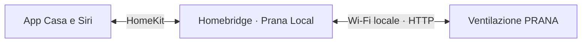
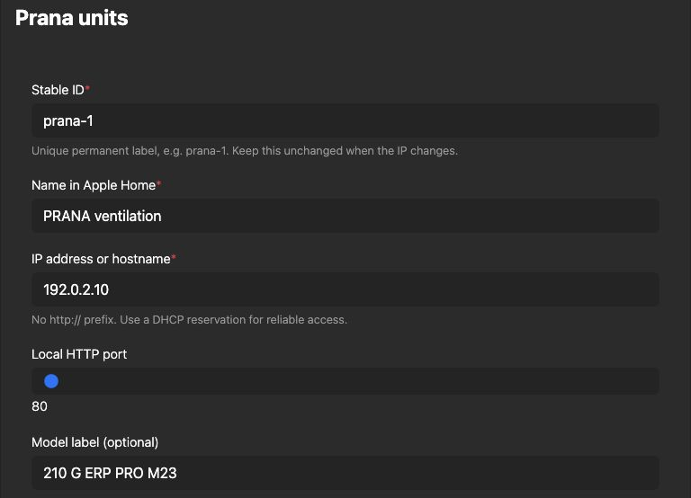

<div align="center">

# Homebridge Prana Local

**La tua ventilazione PRANA, nell'app Casa.**

Regola i flussi, scegli la modalità e consulta i sensori.<br>
Comunicazione Wi-Fi locale, senza account cloud PRANA.

[](https://github.com/viames/homebridge-prana-local/releases/latest)
[](https://github.com/viames/homebridge-prana-local/actions/workflows/test.yml)
[](LICENSE)

[English](README.md) · **Italiano**

[Installazione](#installazione) · [Compatibilità](#compatibilità) · [Configurazione](#configurazione) · [Problemi comuni](#problemi-comuni)

</div>

---

## La ventilazione insieme agli altri accessori di casa

Il plugin collega una PRANA compatibile al tuo Homebridge. Nell'app Casa trovi ventilatore, interruttori delle modalità e sensori disponibili sull'unità. Puoi usarli anche nelle tue scene e automazioni.

| Flussi d'aria | Modalità | Sensori |
| :--- | :--- | :--- |
| Accensione e velocità | AUTO e AUTO+ silenzioso | Temperature interne ed esterne |
| Immissione/estrazione separate, opzionali | Notte e ricambio forzato | Umidità relativa |
| Sincronizzazione dei flussi | Inverno e mini riscaldamento | Stima CO₂ equivalente |



Il collegamento con la PRANA è locale. Homebridge deve restare acceso e raggiungibile; non servono Home Assistant, HACS, MQTT o un gateway Bluetooth. Il controllo remoto tramite Casa dipende dall'hub domestico e dai requisiti Apple.

## Compatibilità

| Componente | Verifica |
| --- | --- |
| **PRANA 210 G ERP PRO M23, firmware 49** | Prove reali di lettura sensori, velocità, accensione/spegnimento e comandi ripetuti |
| **Homebridge 2.4.0 e Node.js 22** | Installazione su Raspberry Pi 3 Model B+, sistema a 32 bit |
| Node.js 22, 24 e 26 | Test automatici in [GitHub Actions](https://github.com/viames/homebridge-prana-local/actions/workflows/test.yml) |
| Libreria HomeKit di Homebridge 1.8.5 | Test dei servizi superati con HAP-NodeJS 0.12.3 e Node 22; la prova fisica usa 2.4.0 |
| Altre PRANA con la stessa API locale | Da verificare sul dispositivo; non risultano provate fisicamente |
| Firmware precedente a 49 o unità solo Bluetooth | Non supportati da questo plugin |

Serve una PRANA già connessa al Wi-Fi, con API locale disponibile e firmware **49 o successivo**, verificabile in Prana Online 2.0. Il solo Wi-Fi non basta a garantire la compatibilità. La sigla commerciale stampata può differire dalla famiglia indicata nell'API.

## Installazione

### 1. Trova l'indirizzo della PRANA

Consulta l'elenco dei dispositivi connessi al router e individua l'indirizzo IPv4 dell'unità. Se possibile, prenotalo nel DHCP del router. Homebridge e PRANA devono potersi raggiungere sulla rete locale.

Puoi controllare l'API aprendo `http://IP-DELLA-PRANA/info`: una risposta compatibile contiene `isValid: true` e firmware almeno 49. Non pubblicare la risposta completa, che include l'identificativo dell'unità. L'API HTTP usa normalmente la porta **80**, anche se il servizio mDNS ne annuncia un'altra.

### 2. Installa il pacchetto GitHub

Prima fai un backup di configurazione e associazioni Homebridge. Conserva anche l'archivio del plugin: i pacchetti installati da GitHub possono non essere inclusi nei backup Homebridge.

Il plugin **non è pubblicato su npm** e non compare nella normale ricerca dei plugin. Nell'immagine ufficiale Raspberry Pi, apri il terminale di Homebridge ed esegui:

```sh
cd /var/lib/homebridge
npm install --omit=dev --ignore-scripts https://github.com/viames/homebridge-prana-local/releases/download/v0.1.1/homebridge-prana-local-0.1.1.tgz
```

Usa l'account proprietario della cartella. Via SSH potrebbe essere necessario passare all'utente del servizio Homebridge. Per un'installazione npm globale già esistente, usa invece `npm install -g --omit=dev --ignore-scripts` con lo stesso URL. Segui le convenzioni di privilegi del tuo impianto.

Su Docker/NAS usa la procedura del tuo installer e la cartella dei plugin effettivamente usata da Homebridge, con persistenza dopo la ricreazione del container. Non installare una seconda copia di Homebridge per risolvere un errore di permessi.

Il pacchetto è pronto all'uso e non richiede build o dipendenze a runtime. La [release](https://github.com/viames/homebridge-prana-local/releases/latest) contiene anche `SHA256SUMS`: dopo il download puoi verificare l'archivio con `shasum -a 256 -c SHA256SUMS` su macOS o `sha256sum -c SHA256SUMS` su Linux.

### 3. Configura il dispositivo

In **Plugins → Homebridge Prana Local → Plugin Actions → Plugin Config** (UI 5.29), aggiungi l'unità. Altre versioni possono chiamare la voce **Impostazioni/Settings**. Scegli un ID stabile come `prana-1`, il nome **Ventilazione PRANA** o quello che preferisci, e inserisci l'indirizzo reale. Imposta `language` su `it` per le etichette italiane. Nessuna stanza è predefinita.



*Schermata di un'istanza separata per la documentazione, con dati di esempio. Non mostra la configurazione di un'abitazione.*

### 4. Riavvia e apri Casa

Riavvia Homebridge una volta e cerca nel log `connected (firmware …)`. All'avvio il plugin legge lo stato e conserva la modalità attiva.

Se il bridge è già associato a Casa, il nuovo accessorio passa attraverso quell'associazione. Un nuovo bridge o un child bridge richiede il proprio abbinamento iniziale tramite QR. Controlla anche la stanza assegnata al bridge.

Scegli la stanza in Casa. Ventilatore, sensori e interruttori possono essere raggruppati: apri le impostazioni dell'accessorio e usa **Mostra come riquadri separati**, se disponibile nella tua versione di Casa.

## Configurazione

Se preferisci JSON, aggiungi questo oggetto all'array `platforms` esistente, conservando bridge e altri plugin:

```json
{
  "platform": "PranaLocal",
  "name": "Prana Local",
  "language": "it",
  "devices": [
    {
      "id": "prana-1",
      "name": "Ventilazione PRANA",
      "host": "192.0.2.10"
    }
  ]
}
```

**Sostituisci `192.0.2.10` con l'indirizzo reale.** È un indirizzo riservato alla documentazione, non un valore operativo.

| Campo | Valore predefinito / funzione |
| --- | --- |
| `id` | ID permanente univoco; se omesso usa l'host, ma è consigliato specificarlo |
| `name` | Nome scelto dall'utente; se omesso il runtime usa `Prana ventilation` |
| `host` | Obbligatorio; IPv4 o hostname risolvibile, senza protocollo o percorso |
| `port` | `80`, porta HTTP |
| `model` | Etichetta commerciale opzionale; non modifica la compatibilità |
| `language` | `en` o `it`; configurabile sulla piattaforma e sul singolo dispositivo via JSON |
| `pollInterval` | `10` secondi, minimo 5; anche per dispositivo via JSON |
| `separateFans` | `false`; abilita anche i controlli separati dei flussi |
| `exposeHeater` | `true`; mostra il mini riscaldamento se segnalato dall'unità |
| `co2Threshold` | `1000` ppm, soglia dello stato CO₂eq anomalo; modulo 400–10000 |
| `timeout` | `5000` ms; intervallo 500–30000 |

Per più unità, aggiungi oggetti all'array `devices` con ID univoci. Configura ogni unità una sola volta. Quando cambia l'IP, modifica `host` e conserva `id` per mantenere l'identità HomeKit. [Esempio completo](docs/configuration.md#multiple-units).

## Come funzionano i comandi

- Il ventilatore principale accende/spegne entrambi i flussi. Se sono separati, mostra la maggiore velocità attiva e imposta entrambi alla percentuale richiesta.
- Le percentuali corrispondono ai passi reali della macchina: su un modello a sei velocità, circa 17% è il passo 1, 33% il passo 2, 50% il passo 3.
- Impostare una velocità manuale esce da AUTO/AUTO+. Con 0% spegni; il massimo dei passi viene letto dal dispositivo.
- Il controllo automatico del ventilatore attiva AUTO. Gli interruttori dedicati permettono anche AUTO+.
- Notte seleziona il minimo; disattivarla sceglie il passo 2 sui flussi attivi. Ricambio forzato seleziona il massimo; disattivarlo sceglie il passo sotto il massimo. Entrambe le uscite disattivano l'automatico.
- I controlli opzionali dei singoli flussi seguono il ventilatore condiviso quando è attiva la sincronizzazione.
- Inverno e mini riscaldamento restano soggetti ai vincoli della macchina. Le prove iniziali non hanno commutato queste due funzioni.

Il firmware 49 può commutare il motore anche quando riceve un comando di accensione ridondante. Il plugin legge lo stato effettivo, evita il comando se è già nello stato richiesto e verifica l'esito. Un comando di velocità non è seguito da un'ulteriore accensione.

## Sensori e limiti

Sono supportate fino a quattro temperature: interna, esterna, aria immessa dopo il recupero e aria espulsa dopo il recupero. La macchina provata ne ha restituite tre, senza `inside_temperature_2`, oltre a umidità e CO₂eq. Compaiono solo i sensori effettivamente segnalati all'avvio.

**CO₂eq è una stima, non una misura diretta né un allarme di sicurezza.** La soglia configura soltanto lo stato anomalo esposto a HomeKit.

VOC e pressione non sono esposti per differenze di unità/rappresentazione in HomeKit. Luminosità, timer, stato filtro ed efficienza non sono implementati da questa release; aggiornamenti firmware e cronologia cloud restano nell'app del produttore.

## Problemi comuni

| Problema | Cosa controllare |
| --- | --- |
| Non trovo il plugin nella ricerca | È distribuito su GitHub, non npm |
| Il plugin non compare dopo l'installazione | Cartella realmente usata da Homebridge e riavvio |
| Non si collega alla PRANA | IP, porta 80, firmware 49+, risposta di `/info` |
| “Nessuna risposta” in Casa | Connettività dell'unità e log; il plugin ritenta automaticamente |
| Sensori mancanti | Campi realmente riportati dalla macchina; riavvia dopo un firmware che aggiunge sensori |
| Nome diverso da quello configurato | Casa può conservare quello assegnato in precedenza: rinominalo lì |
| Cambia modalità regolando la velocità | Il comando manuale esce da AUTO/AUTO+ |

Controlla isolamento della rete ospiti, VLAN, firewall e rete dei container. Un hostname deve risolversi sul dispositivo che esegue Homebridge. Non cancellare l'intero bridge come primo tentativo di soluzione.

Le letture diventano indisponibili dopo un errore di comunicazione; il recupero è automatico. Sono rifiutate se più vecchie del maggiore tra 30 secondi e tre intervalli di polling. All'avvio viene verificata l'identità salvata dell'unità.

## Aggiornamento e rimozione

Per aggiornare, fai un backup, leggi le note di release e installa il nuovo archivio con lo stesso metodo e nella stessa cartella. Mantieni gli ID e riavvia. Per tornare indietro installa l'archivio precedente. Le nuove versioni si trovano nelle release GitHub, non nelle notifiche npm.

Per rimuovere una sola unità, elimina il suo oggetto da `devices` e riavvia il plugin ancora configurato. Per disinstallare tutto, elimina la piattaforma `PranaLocal` e usa il gestore dei plugin oppure `npm uninstall homebridge-prana-local` nella cartella originale (`-g` per installazioni globali). Se rimane un accessorio in cache, rimuovi solo quello PRANA tramite Homebridge. Non occorre riassociare gli altri accessori del bridge.

## Rete e riservatezza

L'API locale usa HTTP senza autenticazione: mantienila su una rete fidata e non esporla su internet con port forwarding. Il plugin non ha analytics o login cloud. Salva localmente l'identificativo dell'unità nella cache accessori per controllo dell'identità e metadati HomeKit.

Il collegamento PRANA–Homebridge funziona sulla LAN senza cloud PRANA. Aggiornamenti, servizi del produttore e controllo remoto Apple hanno requisiti separati. Il dispositivo che esegue Homebridge deve restare disponibile: un portatile in stop interrompe il bridge.

[Segnala un problema o un modello provato](https://github.com/viames/homebridge-prana-local/issues/new/choose) indicando modello, firmware, versioni Homebridge/Node, sistema e un breve log ripulito. Non pubblicare password, codici HomeKit, token, configurazioni complete o identificativi di produzione.

---

Software indipendente della comunità, di [viames](https://github.com/viames), con [licenza MIT](LICENSE). Non affiliato a PRANA o Apple e non verificato dal progetto Homebridge. [Guide tecniche in inglese](docs/configuration.md) · [Contribuire](CONTRIBUTING.md).
