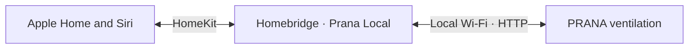
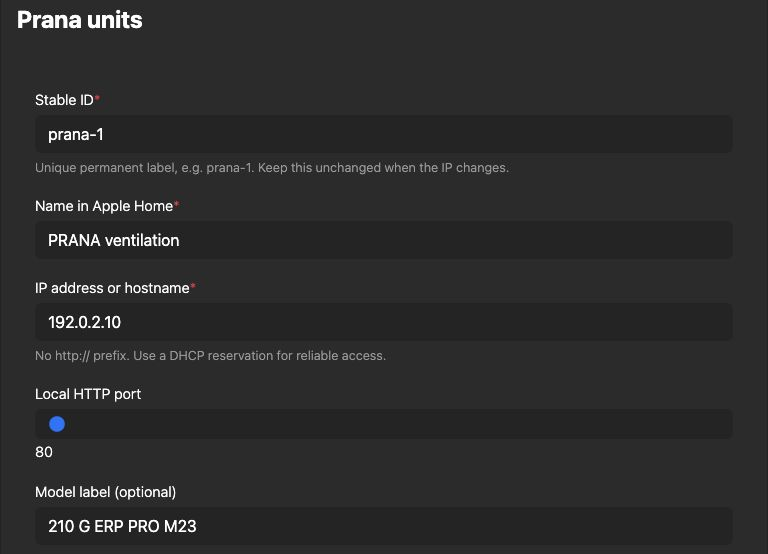

# Homebridge Prana Local

**Your PRANA ventilation, in Apple Home.**

Control airflow, choose a mode and read your room's sensors. 
Local Wi-Fi communication. No PRANA cloud account required.

**English** · [Italiano](README.it.md)

[Get started](#get-started) · [Compatibility](#compatibility) · [Settings](docs/configuration.md) · [Help](docs/troubleshooting.md)

---

## A familiar place for your ventilation

Add a compatible PRANA recuperator to the Homebridge you already use. Apple Home gets a fan, mode switches and the environmental sensors available on your unit. Include these controls in your own Home scenes and automations.

| Airflow | Operating modes | Room conditions |
| :--- | :--- | :--- |
| On/off and speed control | AUTO and quiet AUTO+ | Indoor and outdoor temperatures |
| Optional separate supply/extract controls | Night and Boost presets | Relative humidity |
| Synchronized airflow mode | Winter and mini heater switches | Equivalent CO₂ estimate |

Sensor and heater availability depend on the model. [See exactly how each control behaves →](docs/configuration.md#controls-and-sensors)

Homebridge runs on your always-on host. The plugin talks directly to the PRANA unit; Home Assistant and a Bluetooth gateway are unnecessary. Remote use of Apple Home depends on your Apple home hub and Apple's requirements.

## Compatibility

| Component | Evidence |
| :--- | :--- |
| **PRANA 210 G ERP PRO M23 · firmware 49** | Tested on real hardware: sensor readings, speed, power and repeated power commands |
| **Homebridge 2.4.0 · Node.js 22** | Hardware installation on Raspberry Pi 3 Model B+, 32 bit |
| Node.js 22 / 24 / 26 | Automated tests in [GitHub Actions](https://github.com/viames/homebridge-prana-local/actions/workflows/test.yml) |
| Homebridge 1.8.5 HomeKit library | Service tests pass with HAP-NodeJS 0.12.3 on Node 22; hardware installation uses 2.4.0 |
| Other PRANA models with the same local API | Candidates for community testing; not hardware-verified |
| Firmware below 49, Bluetooth-only units | Unsupported by this plugin |

**Before installing:** your PRANA must be connected to Wi-Fi, expose the local API and run firmware **49 or newer**. Check firmware in Prana Online 2.0. A Wi-Fi connection alone does not establish compatibility.

## Get started

### 1. Find the unit

Open your router's connected-device list and find the PRANA's IPv4 address. Reserve that address if your router supports DHCP reservations. Homebridge and the unit must be able to reach one another on the LAN.

### 2. Install the release

In **Homebridge UI → Plugins**, search for `homebridge-prana-local` and install it. The [npm package](https://www.npmjs.com/package/homebridge-prana-local) and [GitHub release archives](https://github.com/viames/homebridge-prana-local/releases/latest) contain the same ready-to-run plugin. Follow the [installation guide](docs/installation.md) for your Homebridge setup.

### 3. Add your unit

Open the plugin's **Plugin Actions → Plugin Config** (or **Settings**, depending on UI version), add a device and enter its IP address. Choose a permanent ID such as `prana-1` and a name such as **PRANA ventilation**. The name and room are yours to choose; no room is assumed.

*The real Homebridge UI, shown with example data in a separate documentation instance. Replace the example address with your unit's address.*

Prefer JSON? Copy the [minimal configuration](docs/configuration.md#minimal-configuration). The reference includes multiple-unit examples and every optional setting.

### 4. Restart and open Apple Home

Restart Homebridge once. Look for `connected (firmware …)` in the plugin log, then open Apple Home. An already paired bridge carries the new accessory into Home automatically. A new bridge or child bridge needs its own one-time pairing.

Assign the accessory to your chosen room. If controls are grouped, open the accessory settings and choose **Show as Separate Tiles**, where available.

## Read before using the controls

- **Manual speed exits AUTO/AUTO+.** Home's percentage slider maps to the unit's actual speed steps.
- **Night and Boost have explicit exit behavior.** Turning Night off selects step 2; turning Boost off selects the step below maximum. Both actions exit automatic modes.
- **Startup preserves settings.** The plugin reads the unit until you operate a control.
- **CO₂eq is an estimate.** It is not a direct CO₂ measurement or a safety alarm.
- VOC, pressure, display brightness and sleep timers remain in the manufacturer's app; they are not exposed by this release.

[Control behavior and limitations →](docs/configuration.md#controls-and-sensors)

## Guides and support

| I want to… | Open |
| :--- | :--- |
| Install, update or remove the plugin | [Installation guide](docs/installation.md) |
| Configure one or several units | [Configuration reference](docs/configuration.md) |
| Fix “No Response”, missing controls or connection errors | [Troubleshooting and FAQ](docs/troubleshooting.md) |
| Read the guide in Italian | [Documentazione italiana](README.it.md) |
| Report a problem or another supported model | [Open an issue](https://github.com/viames/homebridge-prana-local/issues/new/choose) |
| Contribute code or run checks | [Contributing](CONTRIBUTING.md) |

Keep the local HTTP API inside a trusted network. It has no authentication and must not be exposed through internet port forwarding. [Network details →](docs/troubleshooting.md#network-and-privacy)

---

Independent community software by [viames](https://github.com/viames), under the [MIT license](LICENSE). Not affiliated with PRANA or Apple and not verified by Homebridge. Product names belong to their respective owners.

Built using the local API contract described by the [PRANA Home Assistant integration](https://www.home-assistant.io/integrations/prana/) and [PRANA API client](https://pypi.org/project/prana-api-client/). No Python or Home Assistant runtime is included.
